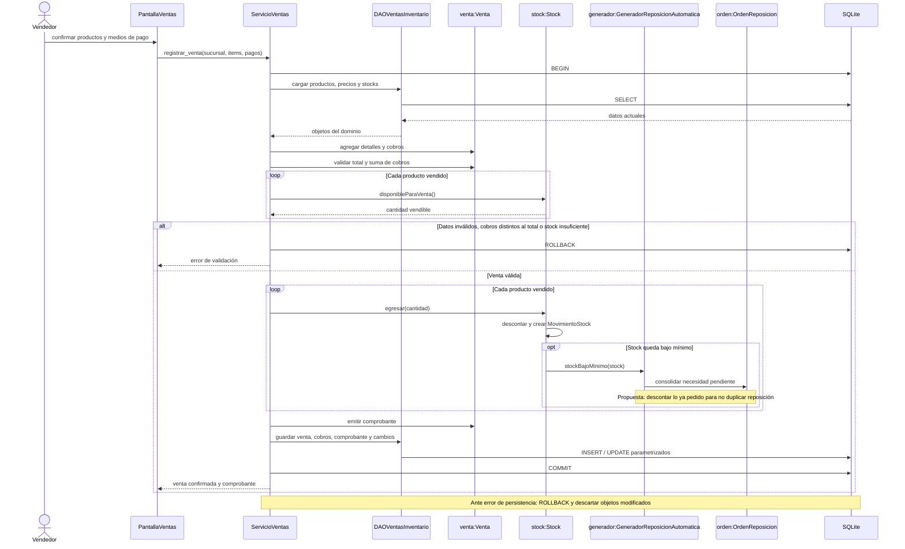
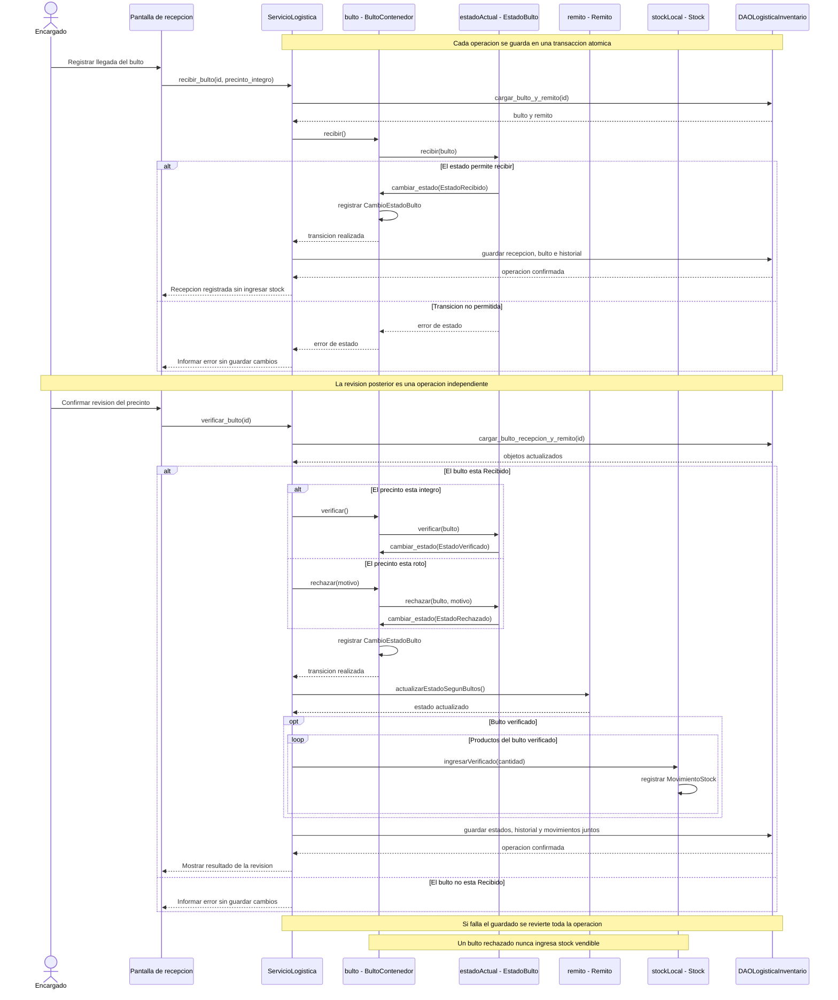

# Diagramas de secuencia — propuesta para validar

Estos diagramas muestran mensajes entre objetos para casos concretos. Complementan el diagrama de clases (estructura), el DER (persistencia) y la máquina de estados (transiciones).

Los servicios y DAO están implementados en `distribucion/`; estos diagramas conservan nombres conceptuales para explicar las colaboraciones. Se usa precio de lista; Strategy queda fuera del alcance inicial.

## 1. Registrar una venta y avisar stock bajo — Observer

Ejemplo: quedan 11 unidades, se venden 2 y el mínimo es 10. Venta, cobros, comprobante, stock, movimientos y eventual reposición deben confirmarse juntos; cualquier error revierte la operación completa. La UI recibe el resultado después del commit.

## 2. Recibir y verificar un bulto — State

Recepción y verificación son acciones distintas. Primero el bulto pasa de En tránsito a Recibido. Después, el estado Recibido permite verificar o rechazar. Cada bulto verificado habilita su contenido; el remito resume los resultados y puede ser parcialmente aceptado. Interpretación pendiente de cátedra.

**Decisión implementada:** verificación individual; solo el bulto correcto ingresa stock. El remito resume los bultos y queda parcialmente aceptado si hay resultados mixtos. Validar esta interpretación con la cátedra. Rechazo no implica merma ni existe estado adicional Disponible.

## Cómo usarlo en Mermaid

Copiar el contenido de cada bloque, desde `sequenceDiagram`, en Mermaid Live o Mermaid Chart. Son dos diagramas independientes. No se publicó ni se modificó ningún diagrama remoto.
