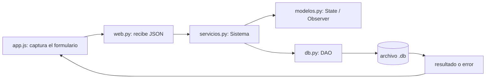
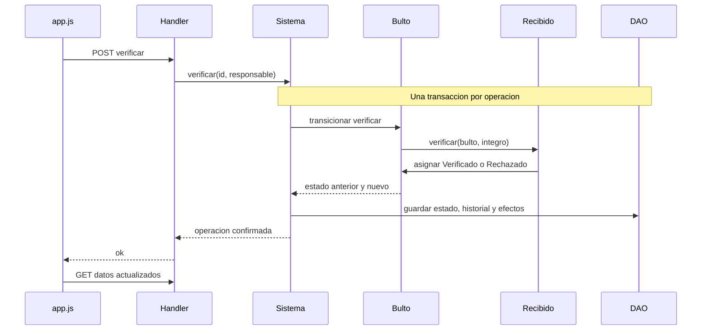

# Explicación del código y de cómo está implementado Andén

Guía de lectura para los integrantes del grupo. El objetivo es poder seguir una operación, encontrar la regla que la controla y explicar por qué se guardan determinados registros. Se describe el código que existe hoy, no una arquitectura ideal ni el modelo preliminar.

## Ficha técnica: cómo está codificado

- **Backend:** Python 3.12+, con clases y funciones. Usa la biblioteca estándar; no usa Flask, Django, FastAPI ni ORM.
- **Frontend:** HTML, CSS y JavaScript directo, sin React ni un proceso de compilación. El servidor entrega esos archivos al navegador.
- **Comunicación:** HTTP y JSON. La interfaz envía datos y recibe resultados; no ejecuta SQL.
- **Persistencia:** SQLite con `sqlite3`, SQL parametrizado y un DAO genérico.
- **Organización:** separación por responsabilidades: presentación, entrada HTTP, casos de uso, objetos del dominio y acceso a datos. No se implementó un framework MVC.
- **Estilo de dominio:** combinación de orientación a objetos —State y Observer— con métodos de servicio que trabajan sobre diccionarios y registros relacionales. No todo el diagrama conceptual se convirtió en una clase Python.
- **Validación:** tipos de entrada en la API; reglas del negocio en servicios/modelos; restricciones relacionales en SQLite. Los controles de pantalla ayudan, pero no reemplazan al servidor.
- **Idioma y nombres:** identificadores mayormente en español, métodos `snake_case`, clases `PascalCase`. Nombres como `fetch`, `render` o `request` siguen convenciones de la interfaz web.

Para empezar: leer los apartados **1–4** para ubicar la estructura; **5–7** para seguir una operación completa; **9–10** para entender objetos y sintaxis; **16–18** para trabajar directamente sobre el código.

## 1. La idea central

La aplicación tiene una pantalla en el navegador, un servidor Python que recibe pedidos y un archivo SQLite que conserva los datos. Entre el servidor y la base, `Sistema` coordina las operaciones de negocio.



Ejemplo: presionar **Verificar bulto** no actualiza la tabla desde JavaScript. La pantalla envía una solicitud; Python valida el pedido, el servicio ejecuta el patrón State, aplica el movimiento de stock y guarda todo junto. La pantalla vuelve a consultar los datos después del éxito.

## 2. Por dónde empezar a leer

No conviene leer todos los archivos completos de entrada. Seguir este orden con el editor y la app abiertos:

1. [demo.py](../distribucion/demo.py): mirar la secuencia de llamadas y reconocer el negocio. Es el ejemplo más corto de uso de `Sistema`.
2. [modelos.py](../distribucion/modelos.py): leer `Bulto`, los estados, `Stock` y el observador. Acá está el comportamiento de los patrones.
3. [servicios.py](../distribucion/servicios.py): seguir `verificar`, `_transicion`, `_mover` y `_avisar`. Después leer `vender` y `devolver`.
4. [db.py](../distribucion/db.py): entender `BaseDatos.transaccion` y los cuatro métodos de `DAO`. El SQL de tablas se puede estudiar después por grupos.
5. [web.py](../distribucion/web.py): seguir `do_POST` → `ejecutar_accion` → método de `Sistema`.
6. [app.js](../distribucion/static/app.js): buscar `openForm`, `gather`, `submitAction` y `load`. No arrancar por todo el HTML que generan las funciones `render...`.
7. [test_sistema.py](../tests/test_sistema.py): leer una prueba del flujo completo y una de error para comprobar qué promete el sistema.

El JavaScript y algunos métodos están escritos de forma compacta. Buscar el nombre de la función en el editor es más útil que memorizar números de línea. La separación de responsabilidades se entiende por quién llama a quién.

## 3. Mapa de archivos

| Archivo | Qué hace | Qué conviene buscar |
|---|---|---|
| `main.py` | Lee argumentos y elige web, escritorio o sin interfaz. | `main`, `--web`, `--db`, `--port` |
| `distribucion/demo.py` | Carga una demo corta ejecutando operaciones del servicio. | `cargar` |
| `distribucion/demo_web.py` | Amplía la demo con productos/locales y bultos en distintas etapas. | `cargar_tablero` |
| `distribucion/modelos.py` | Reglas de valores y objetos de State/Observer. | `dinero`, `cantidad`, `Bulto`, `Stock` |
| `distribucion/servicios.py` | Coordina catálogo, stock, logística, ventas y devoluciones. | `Sistema`, `atomico` |
| `distribucion/db.py` | Define tablas, abre conexión, ejecuta SQL y controla transacciones. | `SCHEMA`, `BaseDatos`, `DAO` |
| `distribucion/reportes.py` | Consulta y agrega datos para los cuatro reportes. | `Reportes.generar` |
| `distribucion/web.py` | Traduce HTTP/JSON a llamadas del servicio y sirve la interfaz. | `Handler`, `ejecutar_accion`, `ServidorLocal` |
| `distribucion/static/index.html` | Estructura base: navegación, contenido y diálogo. | `main`, `dialog`, referencias a JS/CSS |
| `distribucion/static/app.js` | Dibuja pantallas, captura formularios y llama a la API. | `load`, `render`, `gather`, `submitAction` |
| `distribucion/static/styles.css` | Colores, tipografía, layout y adaptación móvil. | `:root`, `.board`, `@media` |
| `distribucion/ui.py` | Interfaz Tkinter alternativa. No participa al usar `--web`. | `Aplicacion` |
| `tests/test_sistema.py` | Verifica reglas y persistencia sin navegador. | pruebas del flujo, State, Observer y rollback |
| `tests/test_web.py` | Verifica HTTP y conexión con los servicios. | JSON, errores, reportes y concurrencia |
| `tests/smoke_web.py` | Recorre la web en Chromium con base temporal. | `probar` |

## 4. Qué ocurre al ejecutar el programa

Con `python3 main.py --web --db demo-anden.db --port 8080`:

1. `argparse` transforma los argumentos en `args.web`, `args.db` y `args.port`.
2. `BaseDatos(args.db)` abre o crea el archivo y asegura las tablas/triggers.
3. `Sistema(base)` construye el coordinador y registra el observador de reposición.
4. Como se eligió web, se cierra esa conexión inicial y se llama `web.servir`.
5. `ServidorLocal` escucha en `127.0.0.1:8080`. Cada solicitud abre y cierra su propia conexión al mismo archivo.
6. El navegador pide `/`, `/styles.css` y `/app.js`. Al iniciar, `app.js` llama `load()` y consulta `/api/datos`.

No se comparte una única conexión SQLite entre hilos. Tampoco se mantiene un gran objeto `Sistema` con todo el negocio cargado para siempre: la web lo construye por solicitud y los datos durables viven en SQLite.

## 5. Primer recorrido completo: verificar un bulto

### 5.1. En la pantalla

Buscar en [app.js](../distribucion/static/app.js):

- `actionFor(b)`: decide qué acción ofrecer visualmente según el estado recibido.
- `openForm('verificar', ...)`: muestra bulto, responsable y motivo si corresponde.
- `gather(form)`: toma los valores del formulario y produce el objeto JSON.
- `submitAction(form)`: hace `POST /api/acciones` y maneja éxito/error.

El pedido tiene esta forma:

```json
{
  "accion": "verificar",
  "id": 9,
  "responsable": "Juan",
  "motivo": ""
}
```

Ese ID es ilustrativo: el bulto debe estar Recibido. La condición del precinto ya se registró al recibir; verificar la consulta del servidor, no acepta que la pantalla invente otra.

### 5.2. En la API

En [web.py](../distribucion/web.py), `do_POST` comprueba ruta, origen, tamaño y JSON. Después abre `BaseDatos` y llama:

```python
resultado = ejecutar_accion(Sistema(base), cuerpo)
```

`ejecutar_accion` acepta solo acciones conocidas y sus campos permitidos; valida tipos y termina con:

```python
return getattr(sistema, accion)(**datos)
```

Con el JSON anterior, esa línea equivale a:

```python
sistema.verificar(id=9, responsable='Juan', motivo='')
```

No se expone cualquier método de `Sistema`: el nombre tiene que pertenecer a la lista explícita de acciones públicas.

### 5.3. En el servicio

`Sistema.verificar` tiene `@atomico`. Dentro de esa transacción:

1. Busca bulto, remito/orden y sucursal de destino mediante un JOIN.
2. Si el precinto no está íntegro exige motivo de rechazo.
3. Llama `_transicion(id, 'verificar', responsable, bool(b['integro']))`.
4. `_transicion` recupera el texto del estado, construye `Bulto(id, ESTADOS[estado]())` y delega a `Bulto.transicionar`.
5. `Recibido.verificar` elige `Verificado()` o `Rechazado()`. Si el estado no permite verificar, lanza error.
6. El servicio guarda el nuevo estado e inserta `historial`.
7. Si fue íntegro, `_mover` suma cada producto al stock local y crea `movimiento`.
8. Recalcula el estado agregado del remito y controla mínimos con `_avisar`.
9. Si todo funcionó, se confirma la transacción. Si algo falló, se revierte todo.

La política de remitos mixtos se explica en [implementacion.md](implementacion.md): la implementación habilita cada bulto aprobado individualmente. Sigue pendiente de validación académica.

### 5.4. De vuelta a la pantalla

La API devuelve éxito con `resultado: null` para este método, porque no retorna un ID nuevo. En un error de negocio devuelve HTTP 400 con un mensaje; un conflicto de integridad SQLite produce 409.

`submitAction` cierra el diálogo y llama a `load()`. La tarjeta cambia de carril porque ahora se dibuja con los datos guardados, no porque el frontend asumió que todo salió bien.



## 6. Segundo recorrido: vender y disparar Observer

Buscar `Sistema.vender` en [servicios.py](../distribucion/servicios.py). Sus pasos son:

1. Validar que la sucursal esté activa y sea LOCAL.
2. Validar productos activos y cantidades positivas.
3. Obtener precios desde la base y sumar con Decimal. El cliente no fija el precio.
4. Validar medios de pago y que los importes sumen el total exacto.
5. Insertar `venta` y asignar su comprobante.
6. Por cada producto, guardar `detalle_venta` con precio/costo histórico.
7. `_mover(..., -cantidad, 'VENTA', ...)` descuenta stock y registra movimiento.
8. `_avisar` construye un `Stock` con disponible y mínimo, y llama `notificar`.
9. El observador puede generar aviso y crear/ampliar reposición.
10. Guardar los cobros. Al salir sin errores, confirmar todo.

**Puede insertarse una venta antes de detectar que falta stock. Eso no deja una venta incompleta:** todavía está dentro de la transacción y un error posterior revierte las inserciones.

### Cómo `_mover` protege el disponible

La condición real es:

```python
if s['cantidad'] + unidades < s['reservada']:
    raise ValueError('Stock disponible insuficiente')
```

`unidades` es negativa en un egreso. Si hay 10 existentes y 4 reservadas, intentar quitar 7 dejaría 3, menor a 4: se rechaza. Quitar 6 deja 4 y respeta las reservas. Esto equivale a no consumir más que `cantidad - reservada`.

### Dónde aparece Observer

```text
vender → _mover → _avisar → Stock.notificar
    → GeneradorReposicionAutomatica.actualizar
    → Sistema.consolidar_faltante → aviso y eventual orden
```

El observador llama al mismo servicio. Eso no abre otra transacción: `consolidar_faltante` no tiene `@atomico`; participa de la que ya abrió la venta. No confundir una llamada de vuelta al servicio con un proceso en background.

Si falla el cobro al final, también se revierten el aviso y la reposición que Observer acababa de crear. Lo demuestra `test_falla_persistencia_revierte_venta_y_observer`.

## 7. La transacción, explicada sin magia

En [servicios.py](../distribucion/servicios.py):

```python
def atomico(metodo):
    @wraps(metodo)
    def ejecutar(self, *args, **kwargs):
        with self.base.transaccion():
            return metodo(self, *args, **kwargs)
    return ejecutar
```

`@atomico` envuelve el método: antes de ejecutar su cuerpo entra en `BaseDatos.transaccion`; al terminar sale del contexto. Es una forma de no repetir el mismo control en cada caso de uso.

En [db.py](../distribucion/db.py):

```python
@contextmanager
def transaccion(self):
    self.conexion.execute('BEGIN IMMEDIATE')
    try:
        yield
        self.conexion.commit()
    except Exception:
        self.conexion.rollback()
        raise
```

- `BEGIN IMMEDIATE`: inicia la transacción de escritura y evita que otra escritura interfiera mientras se valida/guarda el comando.
- `yield`: acá corre el cuerpo del método decorado.
- Si vuelve normalmente, `commit` confirma.
- Si aparece una excepción, `rollback` deshace todo y `raise` deja que el error siga hasta la API.

El DAO usa **la misma conexión**. Si cada inserción confirmara por su cuenta, una venta podría quedar sin cobros o con stock incoherente; por eso `DAO.insertar` no hace commit.

## 8. Qué significa el SQL del DAO

```python
fila = self.dao.uno('SELECT * FROM producto WHERE id=?', (producto_id,))
```

- `?` es un parámetro, no una concatenación del valor en el SQL.
- `(producto_id,)` es una tupla de un elemento; la coma importa.
- `uno` devuelve un diccionario o lanza `ValueError` si no existe.
- `todos` devuelve una lista de diccionarios; una lista vacía es válida.
- `ejecutar` devuelve el cursor de SQLite.
- `insertar` construye un INSERT con columnas internas conocidas y devuelve `lastrowid`.

El código usa interpolación para algunas tablas/columnas, pero esos nombres salen de constantes o listas permitidas. Los valores del usuario van por parámetros.

En `SCHEMA`, `PRIMARY KEY` identifica filas, `FOREIGN KEY/REFERENCES` relaciona entidades, `UNIQUE` impide duplicados y `CHECK` protege condiciones básicas. Los triggers bloquean cambios/borrados de auditoría. La lógica de negocio adicional vive en servicios y modelos.

## 9. Qué objetos hay realmente y qué son tablas

Esta diferencia es importante para no explicar clases inexistentes:

| Concepto | Representación actual |
|---|---|
| Bulto en una operación | Objeto `Bulto` y objeto `EstadoBulto` concreto; además tiene su fila en SQLite. |
| Stock que notifica | Objeto `Stock` creado para el control, con observadores; sus cantidades se leen/escriben en la tabla `stock`. |
| Producto, sucursal, proveedor, venta, remito, orden | Filas SQLite leídas como diccionarios. No hay una clase Python independiente para cada una. |
| Operaciones del negocio | Métodos de `Sistema`, que coordinan validación, objetos y SQL. |
| Acceso a datos | Una clase DAO genérica, no un DAO distinto por entidad. |

Los patrones son orientados a objetos y tienen comportamiento real. El resto usa un servicio central y registros. Es una simplificación de la implementación respecto del diagrama conceptual amplio; **no hay una traducción uno a uno de todas sus clases**.

Si la cátedra exige un modelo de dominio más rico o DAO por entidad, habrá que refactorizar. No hace falta ocultarlo ni cambiarlo para memorizar la defensa: primero entender exactamente lo que se implementó.

## 10. Python que conviene reconocer

| Sintaxis | Significado en este proyecto |
|---|---|
| `self` | La instancia que recibe el método. `self.dao` es el DAO de ese `Sistema`. |
| `@dataclass` | Genera constructor y utilidades a partir de atributos declarados, como en `Bulto`. No guarda nada en la base. |
| `ABC` / `@abstractmethod` | Contrato base y método que una subclase concreta debe implementar, como `ObservadorStock.actualizar`. |
| `field(default_factory=list)` | Da a cada `Stock` su propia lista; evita compartir una misma lista mutable entre instancias por accidente. |
| `_mover`, `_avisar` | `_` indica uso interno por convención; no es una barrera de acceso impuesta por Python. |
| `*args` | Recibe argumentos posicionales adicionales, usados para pasar `integro` a la transición. |
| `**kwargs` / `**datos` | Recibe o expande argumentos con nombre, como `id=9`. |
| `getattr(obj, nombre)` | Busca dinámicamente un atributo/método. Se usa con nombres controlados de acciones/estados. |
| `raise ValueError(...)` | Interrumpe una operación inválida; permite rollback y mensaje al usuario. |
| `Decimal('2500.50')` | Importe decimal exacto a partir de texto; no pasar primero por float. |
| `with ...` | Abre un contexto que se cierra tanto ante éxito como error: transacción, temporal, servidor. |
| `@wraps` | Conserva metadatos del método que envuelve el decorador `atomico`. |

### Ejemplo mínimo de State, sin base ni servidor

Abrir `python3` desde la carpeta del repo y ejecutar (en Windows, `py`):

```python
from distribucion.modelos import Bulto, Preparado
bulto = Bulto(99, Preparado())
bulto.estado.nombre
# 'PREPARADO'
bulto.transicionar('precintar')
# ('PREPARADO', 'PRECINTADO')
bulto.transicionar('recibir')
# ValueError: El bulto no permite recibir
```

Esto cambia un objeto en memoria. No habrá un registro #99 en la base: para persistir y auditar se pasa por el servicio.

## 11. Frontend: qué hace y qué no

`app.js` mantiene una variable `db` con una **copia de datos recibida por HTTP**. Pese al nombre, no es la base SQLite ni persiste nada por sí sola.

- `load`: consulta datos, actualiza `db` y vuelve a dibujar.
- `render` / `renderBoard` / `renderSales` / etc.: generan el contenido visible según sección.
- `openForm` y `field`: construyen los controles de entrada.
- `gather`: convierte números/booleanos y listas al formato esperado por la API. Los importes viajan como texto.
- `request`: llama `fetch`, interpreta JSON y convierte respuestas fallidas en errores de la pantalla.
- `submitAction`: deshabilita confirmar mientras guarda, muestra resultado y recarga datos.
- `esc`: escapa texto al insertarlo dentro de HTML.
- `saleTotal`: cálculo previo en centavos enteros para ayudar al vendedor; el servidor recalcula y valida el total verdadero.

`async/await` permite esperar la respuesta HTTP sin bloquear toda la interfaz. No implica que el cobro sea asíncrono en el dominio ni que se ejecute Observer después en otro proceso.

## 12. Cómo se leen los reportes

En `Reportes.generar(tipo, desde, hasta, sucursal, top)`:

1. Valida fechas, orden del período y `top`.
2. Consulta datos relacionados con JOIN.
3. Filtra y agrupa según el reporte.
4. Usa Decimal para importes y devuelve una lista de diccionarios.

No todos los cálculos están hechos con `GROUP BY` en SQL; varias agregaciones se hacen en Python. En particular se evita `SUM(CAST(monto AS REAL))` para no introducir floats. El costo/precio del detalle es histórico: editar el producto no cambia el margen de una venta pasada.

La API entrega esa lista como JSON o la convierte a CSV. La pantalla no vuelve a calcular los indicadores de negocio.

## 13. Aprender con los tests

Un test tiene preparación, acción y comprobación. Por ejemplo, el de stock insuficiente intenta vender y luego verifica que no quedaron cambios parciales.

Ejecutar uno por vez ayuda a relacionar regla y código:

```bash
python3 -m unittest tests.test_sistema.CasoSistema.test_state_no_doble_ingreso_despacho_recepcion -v
python3 -m unittest tests.test_sistema.CasoSistema.test_observer_no_duplica_pendientes_y_varios_observadores -v
python3 -m unittest tests.test_sistema.CasoSistema.test_falla_persistencia_revierte_venta_y_observer -v
```

Abrir el método del test y sus llamados en paralelo. `assertEqual` compara resultados; `assertRaises` comprueba que una operación inválida lance el error esperado. Un error esperado y capturado por el test significa que esa protección funcionó.

## 14. Sesión de estudio sugerida para los tres

1. **10 minutos:** leer `demo.py` y ubicar cada llamada en la app.
2. **15 minutos:** cada uno explica el State de un bulto y predice una acción válida/inválida antes de ejecutarla.
3. **15 minutos:** seguir una venta y señalar cada tabla que cambia, incluyendo Observer.
4. **10 minutos:** explicar el rollback tardío leyendo su test; qué quedaría roto si hubiera commits dentro del DAO.
5. **10 minutos:** repartir un reporte por persona y explicar fuentes, filtros y cálculo. El cuarto se revisa juntos.

No limitar el estudio a la parte que cada uno hubiera implementado: todos deberían poder seguir al menos una transacción completa.

## 15. Preguntas para comprobar que se entendió

Intentar contestar sin mirar y después verificar en el archivo indicado:

1. ¿En qué archivo se decide si un bulto Recibido puede verificarse? **`modelos.py`, `Recibido.verificar`.**
2. ¿Quién suma el stock local y guarda el historial? **`Sistema.verificar` coordina `_transicion`, `_historial` y `_mover`.**
3. ¿Por qué volver a verificar no suma dos veces? **La segunda transición falla y la operación se revierte.**
4. ¿`db` en JavaScript es SQLite? **No, es una copia de datos consultada por HTTP.**
5. ¿Dónde se compara la suma de cobros con el precio real? **En `Sistema.vender`.**
6. ¿Qué pasa si el último cobro falla después de Observer? **Rollback de la transacción completa.**
7. ¿El objeto State se guarda como instancia Python? **No: se guarda su nombre y se reconstruye al leer.**
8. ¿Por qué otro control de mínimo no vuelve a pedir el mismo faltante? **`consolidar_faltante` descuenta lo ya solicitado y pendiente.**
9. ¿Qué diferencia hay entre `cantidad` y `reservada`? **Existencia y parte comprometida; disponible es su diferencia.**
10. ¿Hay clase `Venta` o `ProductoDAO`? **No en esta versión: venta/producto son registros y hay DAO genérico.**

Para profundizar: [patrones](patrones-de-diseno.md), [persistencia](persistencia.md), [pruebas y decisiones](pruebas-y-decisiones.md) y [defensa](defensa.md).

## 16. Leer un método real, instrucción por instrucción

Este fragmento pertenece a `Bulto` en [modelos.py](../distribucion/modelos.py):

```python
@dataclass
class Bulto:
    id: int
    estado: EstadoBulto

    def transicionar(self, accion, *args):
        anterior = self.estado.nombre
        getattr(self.estado, accion)(self, *args)
        return anterior, self.estado.nombre
```

**`@dataclass`:** evita escribir a mano un constructor simple. Permite crear `Bulto(3, Preparado())`; ese objeto tiene `id=3` y `estado` apuntando a una instancia de `Preparado`.

**`id: int` y `estado: EstadoBulto`:** son anotaciones de tipo, no columnas de SQLite ni validaciones automáticas. Python no impide por sí solo pasar un tipo equivocado; el sistema debe validar sus entradas.

**`self`:** es ese bulto particular. Dos bultos pueden tener objetos de estado diferentes aunque sean de la misma clase `Bulto`.

**`accion`:** es el nombre del método que se quiere ejecutar, como `'precintar'`. El servicio pasa nombres conocidos, no instrucciones de Python escritas por el usuario.

**`*args`:** permite pasar argumentos extra cuando una acción los necesita. Verificar recibe la condición del precinto; precintar no necesita ese parámetro dentro del objeto State.

**`anterior = self.estado.nombre`:** conserva el estado previo antes de ejecutar la operación. Se usa luego para el historial.

**`getattr(self.estado, accion)(self, *args)`:** busca el método en el objeto de estado actual y lo llama, pasándole el bulto como contexto. Si el estado es `Preparado` y la acción es `'precintar'`, equivale a `self.estado.precintar(self)`.

**`return anterior, self.estado.nombre`:** devuelve una tupla de dos valores. El servicio puede recibirla con `anterior, nuevo = obj.transicionar(...)` y persistir el cambio.

La asignación `bulto.estado = Precintado()` cambia la referencia al objeto de estado en memoria. No hace un UPDATE por sí sola. El servicio es quien guarda el nombre nuevo en SQLite y crea el historial, dentro de la transacción.

### Un registro no es lo mismo que un objeto del dominio

```python
fila = {'id': 3, 'estado': 'PREPARADO'}
objeto = Bulto(fila['id'], ESTADOS[fila['estado']]())
```

En la primera línea, el estado es texto. En la segunda, `ESTADOS['PREPARADO']` devuelve la clase `Preparado`; los paréntesis crean una instancia y `Bulto` recibe ese objeto. A partir de ahí puede delegarle comportamiento. El diccionario por sí solo no tiene métodos como `precintar`.

## 17. Qué modifica cada operación del servicio

Este mapa ayuda a encontrar un error o explicar una pantalla. Se indican efectos principales; las validaciones se ejecutan antes o dentro de la misma transacción.

| Método de `Sistema` | Qué representa | Qué registra o cambia |
|---|---|---|
| `guardar` | Alta o modificación del catálogo | Fila de sucursal/categoría/proveedor/producto; devuelve su ID. |
| `baja` | Baja lógica | `activo=0`; conserva registros anteriores. |
| `asociar_proveedor` | Relación de compra | Costo y proveedor principal en `producto_proveedor`. |
| `ingresar_proveedor` | Ingreso al CD | `ingreso`, stock, movimiento y costo actual del producto. |
| `definir_minimo` | Umbral de reposición | Mínimo del stock y eventual aviso/reposición de Observer. |
| `crear_orden` | Pedido CD → local | Cabecera de orden y detalles por producto. |
| `crear_remito` | Agrupar un despacho | Remito asociado a una orden. |
| `preparar_bulto` | Apartar mercadería para enviar | Reserva de stock, bulto, contenido e historial inicial. |
| `precintar` | Cerrar con código de seguridad | Estado, código de precinto e historial. |
| `despachar` | Sacar el remito del CD | Estados de sus bultos, historial, liberación de reservas y egresos. |
| `recibir` | Registrar llegada física | Estado Recibido, condición del precinto e historial; sin ingreso vendible. |
| `verificar` | Aprobar o rechazar el contenido | Estado, historial, motivo, estado agregado del remito y stock si se aprueba; eventual Observer. |
| `vender` | Confirmar operación comercial | Venta, detalles, comprobante, cobros, egresos y eventual reposición. |
| `devolver` | Reintegrar sobre una venta | Devolución, reintegro registrado y reingreso de stock apto. |

`_stock`, `_mover`, `_historial`, `_transicion`, `_avisar` y `_orden` son auxiliares internos. Reutilizan pasos de los casos de uso; no son pantallas ni comandos públicos independientes.

## 18. Cómo abordar un cambio sin perderse

### Si el cambio es visual

Buscar la sección en `render...` de `app.js` y sus clases en `styles.css`. Un cambio de color o espaciado normalmente no requiere tocar SQLite ni `Sistema`.

### Si cambia una regla del negocio

Ejemplo: no permitir devolución después de cierto plazo. La condición debe implementarse en `Sistema.devolver` usando la fecha de venta, y probarse con casos dentro/fuera del plazo. La pantalla puede explicar el límite, pero no debe ser el único lugar que lo controle.

### Si aparece un nuevo dato persistente

Ejemplo: agregar una descripción a los productos. Revisar en conjunto:

1. **Esquema:** columna y cambio de bases ya creadas. `CREATE TABLE IF NOT EXISTS` no agrega columnas a una tabla existente.
2. **Servicio:** campos aceptados y validaciones de `guardar`.
3. **API:** formato y tipos que acepta `ejecutar_accion`.
4. **Interfaz:** formulario, envío y presentación.
5. **Demo y tests:** datos válidos, creación/modificación y compatibilidad esperada.
6. **Documentación:** actualizar el modelo y las instrucciones si cambió el esquema.

La tarea no es agregar el input y confiar en que se guarde automáticamente: cada capa tiene una responsabilidad explícita.

### Si cambia un estado o transición

Revisar la clase concreta en `modelos.py`, su registro en `ESTADOS`, los efectos en `Sistema`, la acción ofrecida por `actionFor` y el carril/nombre en `app.js`. Después actualizar los diagramas y probar tanto el camino válido como los saltos prohibidos. La interfaz no debe permitir una acción que el dominio desconoce ni el dominio depender de que el botón esté oculto.

### Si algo falla al usar la app

1. ¿El formulario envió una solicitud? Revisar la pestaña Network del navegador.
2. ¿La API devuelve un mensaje de validación? Leer el estado HTTP y el JSON.
3. ¿Qué método de `Sistema` corresponde a esa acción? Ubicar la regla y los auxiliares que llama.
4. ¿Falló una transición, un límite de stock o una restricción SQLite? Separar las causas antes de cambiar código.
5. ¿Se revirtió la operación? Verificar los registros, no solo el mensaje visual.

Para entenderlo entre los tres, cada uno puede elegir una operación del apartado 17 y explicarla siguiendo las mismas cinco preguntas. Si puede ubicar datos de entrada, validación, objetos, escrituras y resultado, entendió el recorrido principal.
