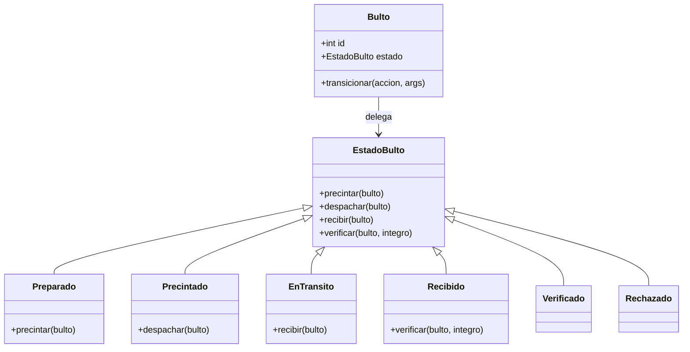
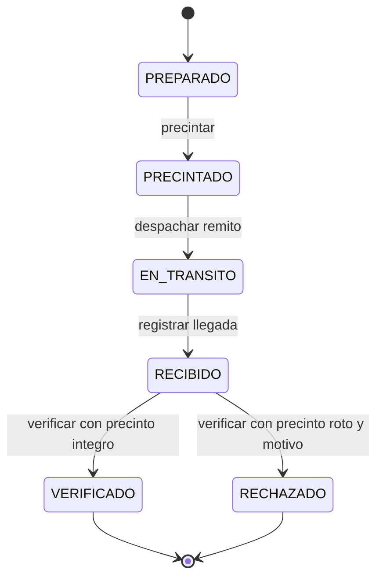
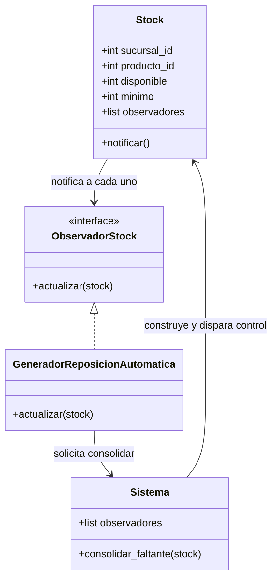
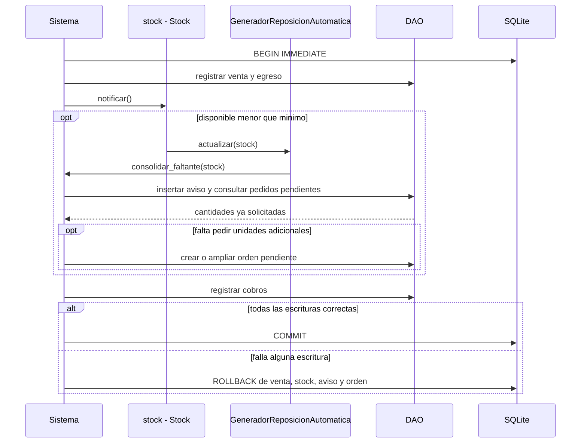
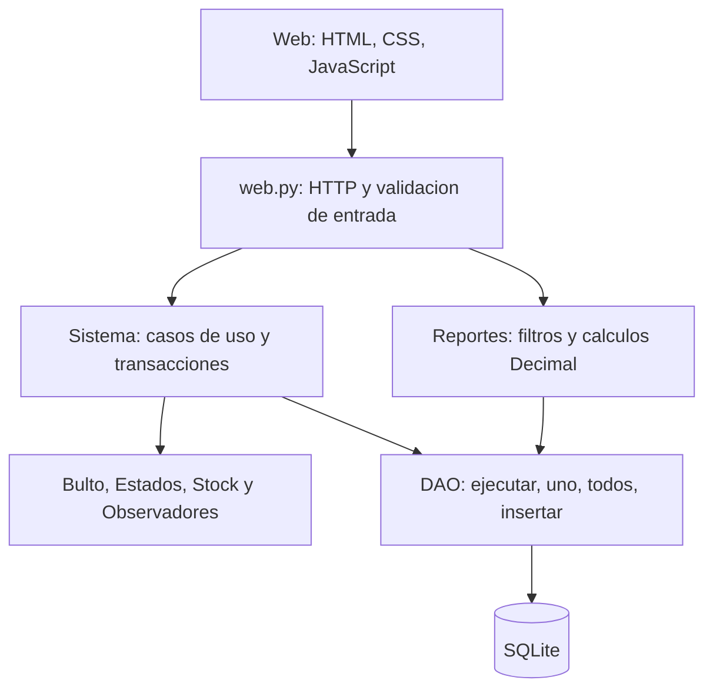

# Patrones de diseño implementados

La implementación usa **State y Observer** como los dos patrones de diseño exigidos por el TP. DAO organiza el acceso a datos. Strategy fue propuesto para precios, pero **no está implementado** y no se presenta como un tercer patrón entregado.

Los diagramas siguientes corresponden al código actual, no a los nombres del modelo preliminar. GitHub los renderiza; el contenido de cada bloque es el código Mermaid para copiar y editar. También hay archivos `.mmd` en [diagramas/](diagramas/).

## 1. State: ciclo de vida del bulto

### Problema que resuelve

La acción permitida depende del estado: un bulto Preparado puede precintarse pero no despacharse; uno Verificado no puede volver a recibirse/verificarse. Repartir estas reglas en UI, API y varios `if estado == ...` las volvería fáciles de contradecir.

### Objetos y responsabilidades

Código: [modelos.py](../distribucion/modelos.py), [servicios.py](../distribucion/servicios.py).

- **Contexto `Bulto`:** mantiene un objeto `estado: EstadoBulto`. `transicionar(accion, *args)` le delega la operación y devuelve nombre anterior/nuevo.
- **Contrato `EstadoBulto`:** define operaciones que por defecto lanzan error. Aunque hereda de ABC, no tiene métodos abstractos: el rechazo por defecto es deliberado para estados terminales.
- **Estados concretos:** `Preparado`, `Precintado`, `EnTransito`, `Recibido`, `Verificado`, `Rechazado`. Cada uno sobrescribe solo lo permitido.
- **`Sistema`:** recupera el estado guardado, reconstruye el objeto mediante `ESTADOS`, ejecuta la transición y persiste estado/historial/efectos en una transacción. La UI no decide si una transición está permitida.

`ESTADOS` es un mapa para reconstruir estados desde SQLite; no reemplaza el polimorfismo. La decisión de permitir/denegar está en el objeto Estado.

### Diagrama de clases y código Mermaid



### Máquina de estados y código Mermaid



“Disponible” es la condición del stock, no un séptimo estado del bulto. Recibido todavía no habilita venta. El remito tiene su propio estado agregado; no se modeló con el mismo State.

### Ejemplo real del código

```python
class Preparado(EstadoBulto):
    nombre = 'PREPARADO'

    def precintar(self, bulto):
        bulto.estado = Precintado()
```

`Verificado` y `Rechazado` no sobrescriben las operaciones: heredan los errores de `EstadoBulto`. Así un reintento no genera otro movimiento de ingreso. El código que suma stock está en el servicio y se ejecuta solo si la transición tuvo éxito.

### Cómo demostrarlo

Recorrer un bulto desde el tablero. Luego intentar volver a verificarlo por API o mostrar `test_state_no_doble_ingreso_despacho_recepcion`. También `test_despacho_atomico_todos_precintados` demuestra que un remito no se despacha parcialmente si algún bulto no permite la acción.

### Límite/decisión a validar

Un bulto verificado habilita su contenido aunque el remito tenga otro rechazado; el remito termina parcialmente aceptado. Esta interpretación fue adoptada para avanzar y está pendiente de cátedra. No atribuirla al patrón: State controla transiciones; la política de recepción parcial es una regla de negocio.

## 2. Observer: stock bajo y reposición

### Problema que resuelve

Cuando un stock queda por debajo del mínimo, pueden reaccionar distintos interesados. El stock no debería conocer cómo se busca un CD, se crea una orden o se descuenta lo pendiente.

### Objetos y responsabilidades

- **Sujeto `Stock`:** recibe sucursal, producto, disponible, mínimo y lista de observadores. `notificar()` compara disponible con mínimo y llama `actualizar(self)` a cada observador.
- **Contrato `ObservadorStock`:** declara el método abstracto `actualizar(stock)`.
- **Observador concreto `GeneradorReposicionAutomatica`:** implementa `actualizar` y delega a `Sistema.consolidar_faltante(stock)`.
- **`Sistema`:** registra el observador al construirse y, después de venta/verificación o cambio de mínimo, crea una vista del stock y llama a `notificar()`.

### Diagrama de clases y código Mermaid



### Secuencia y código Mermaid



### Cálculo concreto

```text
faltante físico = mínimo − disponible
pendiente = cantidad solicitada − cantidad en bultos verificados/rechazados
nuevo pedido = faltante físico − pendiente
```

Solo se piden unidades adicionales si `nuevo pedido > 0`. Si hay una orden aún sin remitos se consolida ahí; si ya comenzó logística, se genera otra. Con varios CD activos, la reposición automática usa el de menor ID. Si el stock bajo pertenece al CD, se registra aviso pero no se crea una orden CD → CD.

### Ejemplo real del código

```python
class GeneradorReposicionAutomatica(ObservadorStock):
    def __init__(self, servicio):
        self.servicio = servicio

    def actualizar(self, stock):
        self.servicio.consolidar_faltante(stock)
```

La implementación es **síncrona y en memoria**, dentro de la transacción de negocio. No hay cola, proceso en background, notificación por correo ni un evento persistente esperando ser procesado. Sí se persisten el aviso y las órdenes resultantes.

### Cómo demostrarlo

Mostrar stock por debajo del mínimo y la orden generada. Repetir el control para comprobar que no se duplican cantidades pendientes. `test_observer_no_duplica_pendientes_y_varios_observadores` registra otro observador y verifica que ambos reciben el evento; `test_falla_persistencia_revierte_venta_y_observer` prueba el rollback completo.

## 3. DAO y capas: persistir sin mezclarlo con la pantalla

DAO es un patrón de acceso a datos; **no lo contamos como uno de los dos GoF exigidos**, que ya son State y Observer.



El DAO actual es genérico y encapsula ejecución/lectura/inserción parametrizada. Las consultas específicas están en servicios/reportes; no afirmar que hay un `ProductoDAO` o `VentaDAO`, porque esas clases no existen. Los servicios poseen el commit/rollback para que una operación con varias tablas sea atómica.

SQLite persiste nombres de estado y datos; al leer, `ESTADOS` reconstruye el objeto State. Observer se vuelve a registrar al crear `Sistema`. No se guardan instancias Python con pickle ni se depende de mantenerlas vivas entre solicitudes.

## 4. Strategy: propuesto, no implementado

Podría encapsular cálculo de precio de lista, promoción y volumen detrás de una misma interfaz. Hoy se usa el precio del producto y se guarda en el detalle de venta. No hay interfaz `EstrategiaPrecio` ni implementaciones concretas, por lo que no hay un diagrama de Strategy presentado como código entregado.

## Archivos y pruebas para la defensa

- [modelos.py](../distribucion/modelos.py): State y Observer.
- [servicios.py](../distribucion/servicios.py): transiciones, reposición y atomicidad.
- [db.py](../distribucion/db.py): DAO, esquema, FK y triggers.
- [test_sistema.py](../tests/test_sistema.py): reglas y pruebas de los patrones.
- [secuencias.md](diagramas/secuencias.md): secuencias ampliadas de venta y recepción.
- `.mmd` de este documento: `state-clases`, `state-estados`, `observer-clases`, `observer-secuencia`, `arquitectura-capas` en [diagramas/](diagramas/).
