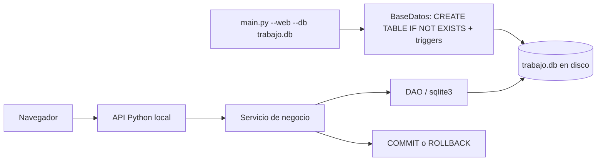

# Persistencia: qué subimos y cómo se comparte

## Decisión para esta rama

**Conservar SQLite y una base local por integrante.** Para subir el TP a GitHub no hace falta cambiar a PostgreSQL ni enviar el archivo `.db`.

Se versionan:

- `distribucion/db.py`: esquema SQL, restricciones, triggers, conexión y DAO.
- `distribucion/demo.py` y `demo_web.py`: datos reproducibles cargados mediante los servicios.
- Servicios, API, interfaz, pruebas e instrucciones.

Se excluyen con `.gitignore`: `*.db`, journals/WAL/SHM, entornos virtuales, cachés y secretos locales. La base contiene registros de ejecución; Git no es un mecanismo de sincronización de SQLite.

## Qué ocurre al arrancar



El archivo se crea si no existe. El esquema usa `CREATE ... IF NOT EXISTS`, por lo que iniciar otra vez no borra tablas ni datos. Cada solicitud web abre su conexión al **mismo archivo** y la cierra al finalizar. Cada conexión activa `PRAGMA foreign_keys = ON`.

Cada comando de negocio abre `BEGIN IMMEDIATE`: se serializan las escrituras y se confirma todo o se revierte todo. Las lecturas/reportes no crean nuevas ventas ni movimientos.

**Importante:** crear tablas si faltan no es un sistema de migraciones. Si en el futuro cambia una tabla existente, hay que versionar una migración o generar una base demo nueva. No borrar trabajo real para “actualizar” el esquema.

## Tres formas de usarla

### Demo del grupo

```bash
python3 -m distribucion.demo_web --db demo-anden.db
python3 main.py --web --db demo-anden.db
```

Solo el primer comando requiere base vacía. Todos parten de los mismos datos sintéticos, pero cada máquina guarda sus propias pruebas.

### Datos propios desde cero

```bash
python3 main.py --web --db trabajo.db
```

Crear primero CD y local, categoría, proveedor y producto; registrar ingreso al CD. El local recibe stock únicamente por logística verificada. Esta interfaz identifica el entorno como demostración porque la rama está destinada a pruebas académicas, no a operación real.

### Comprobar que persiste

1. Crear una categoría o registrar una operación y anotar su nombre/comprobante.
2. Detener el servidor con Ctrl+C.
3. Ejecutar nuevamente el servidor con **el mismo archivo y desde la misma carpeta**.
4. Volver a consultar: el registro debe seguir existiendo.

Cambiar `--db`, ejecutar desde otra carpeta con ruta relativa, o crear un archivo distinto significa abrir otra base. No es pérdida de datos de la anterior.

## Inspeccionar y respaldar

Abrir el archivo con DB Browser for SQLite para ver tablas, sin modificar historial/movimientos. También se puede consultar con Python, sin instalar nada:

```bash
python3 -c "import sqlite3; c=sqlite3.connect('demo-anden.db'); print(c.execute('SELECT id, comprobante, total FROM venta').fetchall()); c.close()"
```

Respaldo simple para el TP: detener el servidor y copiar la base a otra carpeta. Mantener la copia fuera de Git. En macOS/Linux:

```bash
mkdir -p respaldos
cp demo-anden.db respaldos/defensa.db
```

En PowerShell/Windows:

```powershell
New-Item -ItemType Directory -Force respaldos
Copy-Item demo-anden.db respaldos/defensa.db
```

Usar un nombre distinto para cada respaldo que se quiera conservar. No copiar solo el `.db` mientras hay escrituras abiertas; para respaldos en caliente corresponde la API de backup de SQLite. No se implementó backup automático.

## ¿Y una base compartida o un despliegue?

**Subir a GitHub y desplegar son tareas diferentes.** Esta entrega permite clonar y ejecutar localmente. GitHub Pages solo sirve archivos estáticos y no ejecuta el backend Python/SQLite.

Para que los tres usen los mismos registros, tendría que existir **un backend único** al que se conecten los navegadores. En un futuro despliegue, SQLite puede funcionar en una única instancia con volumen persistente y backups; PostgreSQL sería una alternativa si se necesitan varias instancias/escrituras concurrentes mayores.

No se publica este servidor directamente: actualmente escucha solo en `127.0.0.1`, valida Host/Origin locales y no implementa autenticación. Un despliegue requeriría adaptar la configuración, acceso, HTTPS, almacenamiento persistente y respaldo. Eso no está hecho ni es necesario para pushear y probar la rama.

## Límites que hay que defender con honestidad

- El DAO actual es una clase de operaciones SQL comunes; los servicios contienen las consultas particulares del dominio. No hay un DAO dedicado por entidad.
- Los objetos State/Observer viven en memoria durante el caso de uso. Se guardan sus datos y efectos, no objetos Python serializados.
- Los triggers protegen las operaciones normales; alguien con acceso administrativo al archivo puede alterar el esquema.
- El responsable se ingresa manualmente y no acredita identidad autenticada.
- Reintentar una verificación no duplica stock; confirmar dos ventas nuevas sí registra dos operaciones. No hay clave de idempotencia de ventas.
